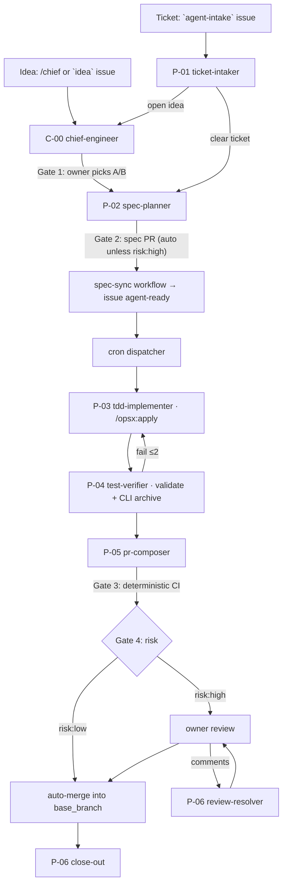

# Agent Factory

> Idea → 2 options → OpenSpec change → issue → PR → risk-based merge.
> The owner decides *what* and *why*. Agents decide *how*, inside guardrails.

---

## What This Is

Agent Factory is the control plane (`hq`) for a portfolio of personal projects run with Claude Code agents.
You type an idea. The chief engineer gives you 2 options. You pick one.
Agents write the OpenSpec change, implement it with TDD, verify it, and open a PR.
`risk:low` PRs merge when every blocking gate is green. `risk:high` PRs wait for you.

The operating blueprint (roles, cadence, rollout) is in [`agent-company/`](agent-company/README.md).
This repo holds the parts every run reads: agents, KB, and `portfolio.yml`.



Any agent can stop the flow with `needs-human`. It then appears in the daily digest.

---

## Workspace Structure

```
agent-factory/
├── README.md                ← you are here
├── README-pipeline.md       ← phase map, gates, triggers
├── ROADMAP.md               ← milestones ↔ autonomy levels
├── portfolio.yml            ← projects: connector, base branch, autonomy, budget, gates
├── agent-company/           ← operating blueprint + workflow templates
├── kb/                      ← knowledge layer: agents read it, never edit it
│   ├── KB-connector-contract.md       ← the ~10 Git-host/tracker operations (GitHub only)
│   ├── KB-risk-policy.md              ← risk:high rules, guardrails, cost limits
│   ├── KB-workflow-conventions.md     ← labels, branches, PR/issue templates
│   ├── KB-context-handoff-contract.md ← JSON payload for stateless sessions
│   ├── KB-tdd-protocol.md             ← red/green per scenario, stuck detection
│   ├── KB-definition-of-done.md       ← objective checklist per project
│   ├── KB-tech-stack.md               ← gate/test commands per project
│   ├── KB-repo-map.md                 ← multi-repo rules (template, no project yet)
│   └── KB-north-star-principles.md    ← 9 immutable rules
├── agents/
│   ├── C-00-chief-engineer/SKILL.md
│   ├── P-01-ticket-intaker/SKILL.md
│   ├── P-02-spec-planner/SKILL.md
│   ├── P-03-tdd-implementer/SKILL.md
│   ├── P-04-test-verifier/SKILL.md
│   ├── P-05-pr-composer/SKILL.md
│   └── P-06-review-resolver/SKILL.md
└── runs/                     ← local handoff JSON (git-ignored)
```

Specs do **not** live here. Each project repo has its own `openspec/` folder:

```
<project repo>/openspec/
├── specs/                       ← living specs (current behavior)
└── changes/<change-id>/         ← proposal.md, design.md, tasks.md, specs/…, agent.yml
    └── archive/                 ← archived by P-04 with the OpenSpec CLI
```

---

## Agent Reference

| ID | Agent | Gate | Input | Output |
|---|---|---|---|---|
| C-00 | chief-engineer | ✅ Gate 1 — option choice | Idea | 2 options → `planning` handoff |
| P-01 | ticket-intaker | — | `agent-intake` issue | Brief → P-02 (or C-00) |
| P-02 | spec-planner | ✅ Gate 2 — spec PR | Chosen option / brief | OpenSpec change + `agent.yml` + spec PR |
| P-03 | tdd-implementer | soft — all checks green | `agent-ready` issue (dispatcher) | Commits on `agent/<change-id>` |
| P-04 | test-verifier | soft — DoD, max 2 retries | Branch | Archive commit + verification table |
| P-05 | pr-composer | ✅ Gate 3 — CI | Verified branch | PR into `base_branch` |
| P-06 | review-resolver | ✅ Gate 4 — `risk:high` review | Owner comments / CI failure | Fix commits; close-out on merge |

## KB File Reference

| File | Purpose | Changes when |
|---|---|---|
| `KB-connector-contract.md` | The operations agents may call, mapped to `gh` commands | An agent SOP needs a new operation |
| `KB-risk-policy.md` | What is `risk:high`; triggers, permissions, cost limits | Owner decision only |
| `KB-workflow-conventions.md` | Labels, branches, comment format, PR/issue templates | Workflow changes |
| `KB-context-handoff-contract.md` | Handoff JSON schema | Handoff fields change |
| `KB-tdd-protocol.md` | Red/green per scenario, commit rules, stuck detection | TDD conventions change |
| `KB-definition-of-done.md` | Objective DoD per project | Quality standards change |
| `KB-tech-stack.md` | Gate and test commands per project | Tooling changes |
| `KB-repo-map.md` | Multi-repo touch order and labels (template) | A multi-repo project changes |
| `KB-north-star-principles.md` | 9 immutable rules | Rarely |

---

## Connectors

| Connector | Tracker | Code host | Runner | Status |
|---|---|---|---|---|
| `github` | GitHub Issues | GitHub | claude-code-action (CI) / Claude Code (local) | **active** |
| `bitbucket` | Jira | Bitbucket | Local Node daemon | not implemented |

Agents only call operations from [`KB-connector-contract.md`](kb/KB-connector-contract.md).

---

## Pilot project: modern-java

| | |
|---|---|
| Repo | `thaiquangquy/ModernJava` (fork — never target `bowbahdoe/ModernJava`) |
| Type | content (mdBook) |
| Branches | agents work on `develop`; `master` deploys GitHub Pages and is owner-only |
| Gates | `mdbook build`, TOC check on `src/SUMMARY.md`, markdownlint (blocking); LanguageTool (advisory) |
| Autonomy | L2 now → L3 after 2 sprints meeting the exit criteria |

Setup steps: [`agent-company/09-rollout-plan.md`](agent-company/09-rollout-plan.md).

---

## Running locally (before the workflows exist)

Each SKILL.md can run in a local Claude Code session.

**1 — Idea → options (in this repo):**
```
Read agents/C-00-chief-engineer/SKILL.md and portfolio.yml.
Idea: <your idea>
```
Reply `A`, `B`, `<letter> with <change>`, or `drop`.

**2 — Write the change (C-00 hands off, or run directly):**
```
Read agents/P-02-spec-planner/SKILL.md and kb/KB-risk-policy.md.
Planning handoff: runs/<project>/<change-id>/handoff-planning-<ts>.json
```
Merge the spec PR (or let auto-merge do it for `risk:low`).

**3 — Implement → verify → PR (in the project repo):**
```
Read agents/P-03-tdd-implementer/SKILL.md, then P-04 and P-05, and kb/KB-tdd-protocol.md.
Implementing handoff: runs/<project>/<change-id>/handoff-implementing-<ts>.json
```

**4 — Review:** comment on the PR, then run P-06 with a `review-resolving` handoff.

---

## Extending the Factory

### Adding a project
1. Add an entry to `portfolio.yml` (connector, `base_branch`, autonomy, budget, gates)
2. Add a section to `kb/KB-tech-stack.md` with the gate commands
3. Add project-specific items to `kb/KB-definition-of-done.md`
4. In the project repo: `openspec init --tools claude`, then the thin caller workflow from `agent-company/templates/`
5. No agent changes needed

### Adding an agent
Use the 8-section SKILL.md structure (see `agents/P-01-ticket-intaker/SKILL.md`):
frontmatter, Vai trò, Phạm vi, Năng lực, Cộng tác, Khi nào trigger, Quy trình chi tiết (SOP), DoD, Anti-pattern, Changelog.

Quality checklist:
- [ ] Role fits in 1–2 sentences
- [ ] Input and output are concrete paths or connector operations
- [ ] SOP steps have verbs and objects
- [ ] DoD is a checklist
- [ ] At least 3 anti-patterns
- [ ] Facts go in a `KB-*.md` file, not in the SKILL.md

---

## Naming Conventions

| Pattern | Meaning | Example |
|---|---|---|
| `KB-{topic}.md` | Knowledge Base entry | `KB-risk-policy.md` |
| `README-{slug}.md` | Index/overview | `README-pipeline.md` |
| `{C\|P\|M\|H\|F}-{NN}-{slug}/SKILL.md` | Agent (C = chief, P = pipeline, M = meta, H = helper, F = feedback) | `P-03-tdd-implementer/SKILL.md` |
| `<change-id>` | OpenSpec change, kebab-case, verb first | `add-records-chapter` |
| `spec/<change-id>`, `agent/<change-id>` | Spec and implementation branches | `agent/add-records-chapter` |
| `handoff-{session_type}-{timestamp}.json` | Local session context (`runs/`) | `handoff-implementing-20261013.json` |

**ID rules:**
- IDs never change after first use
- Deprecate with `status: deprecated` + `pointer` in frontmatter; do not delete agents or KB files
- Cross-references use relative paths

---

## For AI Sessions Reading This

1. **Your source of truth is the OpenSpec change** named in your handoff (`change_path`). Read it first.
2. **Your role is the SKILL.md you were given.** Do not do work outside its SOP.
3. **Spec deltas are read-only after the spec PR merges.** If the spec is wrong: comment, add `needs-human`, halt.
4. **No valid handoff, no work.** Emit `HANDOFF_ERROR: missing required fields: [list]` and stop.
5. **Only call connector operations** from `kb/KB-connector-contract.md`. Always pass `--repo` from `portfolio.yml`.
6. **Stuck means halt.** Respect the retry limits in `kb/KB-tdd-protocol.md`.
7. **Risk only goes up.** Follow `kb/KB-risk-policy.md`.
