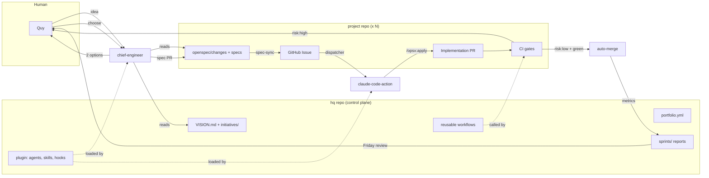

# 03 — Architecture

## Control plane and data plane

The system has two kinds of repos.

- **`hq` (control plane), 1 repo.** It holds the vision, the portfolio, shared agents and skills, reusable workflows, and sprint reports.
- **Project repos (data plane), N repos.** Each one holds code or content, its own `openspec/` folder, and thin caller workflows.

An analogy: `hq` is head office. It sets policy and keeps the books. Project repos are the factory floors. They do the work under head-office policy.



## `hq` repo layout

```
hq/
├── VISION.md                      # 1 page. Mission, 3–5 goals, non-goals.
├── portfolio.yml                  # All projects, type, repo, autonomy level, budget
├── initiatives/
│   └── 2026-Q4-modern-java-course.md
├── sprints/
│   ├── 2026-S21/report.md         # Generated by sprint-reporter
│   └── 2026-S21/decisions.md      # Written by you during review
├── rules/
│   └── risk-policy.md             # What counts as risk:high
├── evals/                         # Shared promptfoo suites (brand voice, PR quality)
├── .claude-plugin/marketplace.json
├── plugins/company-core/
│   ├── agents/
│   │   ├── chief-engineer.md
│   │   ├── reviewer.md
│   │   ├── editor.md
│   │   ├── learning.md
│   │   └── sprint-reporter.md
│   ├── skills/                    # spring-boot-conventions, react-conventions, brand-voice, ...
│   ├── commands/chief.md
│   └── hooks/hooks.json           # Block secrets, block force-push, run formatter
└── .github/workflows/
    ├── reusable-spec-sync.yml     # on: workflow_call
    ├── reusable-dispatcher.yml
    ├── reusable-agent-run.yml
    ├── reusable-verify.yml
    ├── daily-digest.yml           # schedule
    ├── sprint-report.yml          # schedule
    └── weekly-learning.yml        # schedule
```

## Project repo layout

```
project-x/
├── CLAUDE.md                      # Project facts + "Learned rules" section
├── openspec/
│   ├── specs/                     # Living specs (current behavior)
│   └── changes/<change-id>/
│       ├── proposal.md
│       ├── design.md
│       ├── tasks.md
│       ├── specs/…                # Spec deltas
│       └── agent.yml              # Our metadata: initiative, priority, risk
├── .claude/
│   ├── settings.json              # Enables company-core plugin from hq marketplace
│   └── agent-memory/              # Subagent memory, versioned
├── evals/                         # Project-specific promptfoo cases (optional)
└── .github/workflows/
    ├── ci.yml                     # Lint, tests, build (project-specific)
    └── agents.yml                 # ~20 lines. Calls the hq reusable workflows.
```

`agent.yml` is our own file. It keeps custom fields out of OpenSpec's `.openspec.yaml`, so OpenSpec upgrades do not break it.

```yaml
# openspec/changes/add-rate-limit/agent.yml
initiative: 2026-Q4-platform-hardening
priority: p1          # p0 | p1 | p2 | p3
risk: high            # low | high  (see hq/rules/risk-policy.md)
type: code            # code | content
estimate: m           # s | m | l
requested_by: quy
```

## `portfolio.yml`

```yaml
projects:
  - id: course-java
    repo: quythai/course-modern-java
    type: code
    autonomy: L3
    budget_usd_per_sprint: 40
    auto_merge: risk_low_only
  - id: content-studio
    repo: quythai/content-studio
    type: content
    autonomy: L3
    budget_usd_per_sprint: 15
    auto_merge: risk_low_only
  - id: client-acme
    repo: quythai/acme-portal
    type: code
    autonomy: L2           # client work: every PR reviewed
    budget_usd_per_sprint: 60
    auto_merge: never
```

The dispatcher and the sprint reporter read this file.
`autonomy` and `auto_merge` here override any label on a PR.

## GitHub Projects board (one org-level board)

| Field | Type | Values |
|---|---|---|
| Project | Single select | From `portfolio.yml` |
| Priority | Single select | p0, p1, p2, p3 |
| Risk | Single select | low, high |
| Type | Single select | code, content |
| Status | Single select | Proposed, Ready, Running, In review, Needs human, Done |
| Sprint | Iteration | 2-week iterations, start Monday, review Friday |
| Initiative | Text | Initiative id |
| Cost (USD) | Number | Filled by agent-run |

## Labels (same in every repo)

| Label | Meaning | Set by |
|---|---|---|
| `idea` | Raw idea for the chief engineer (phone entry) | Human |
| `agent-ready` | Dispatcher can pick it | spec-sync |
| `agent-running` | An agent works on it now | Dispatcher |
| `needs-human` | Agent stopped. Human input needed. | Agent or CI |
| `priority:p0`…`priority:p3` | Priority | spec-sync |
| `risk:low`, `risk:high` | Review policy | spec-sync (from `agent.yml`) |
| `change:<id>` | Links issue and PR to an OpenSpec change | spec-sync |

## Event flow (one change)

| # | Event | Component | Output |
|---|---|---|---|
| 1 | You send an idea | `chief-engineer` | 2 options |
| 2 | You choose | `chief-engineer` | Spec PR with `openspec/changes/<id>/` |
| 3 | Spec PR merges | `spec-sync` | Issue + board item, `agent-ready` |
| 4 | Cron, every 30 min | `dispatcher` | Picks top issue, sets `agent-running` |
| 5 | Dispatcher calls | `agent-run` (claude-code-action) | Implementation PR, archive included |
| 6 | PR opens | `ci` + `verify` + `reviewer` | Gate results, review comments |
| 7 | Gates green | GitHub auto-merge or you | Merge, issue closes |
| 8 | Daily 05:00 | `daily-digest` | Telegram message |
| 9 | Sprint end | `sprint-report` | `hq/sprints/<id>/report.md` |
| 10 | Weekly | `learning` | PRs to skills and rules |

## Why the dispatcher uses cron, not the label event

GitHub `concurrency` keeps **only one** pending run per group. Other pending runs are cancelled.
If 5 issues get `agent-ready` at the same time, a label-triggered workflow with a concurrency group loses 3 of them.
A cron dispatcher that picks the top issue each time does not lose work, and it applies priority order.
